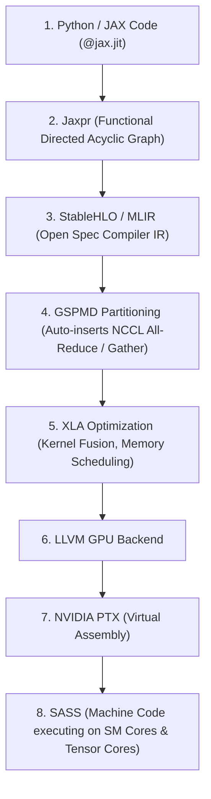

# Distributed GPU Compute Lab: Architecture, Collectives & Ring Topologies

This document explains the technical architecture, mathematical mechanics, and practical findings from running simulated distributed GPU clusters on a single NVIDIA GeForce RTX 5090 using JAX, OpenXLA, and NCCL.

---

## 1. High-Level Architecture & Compilation Pipeline

### How JAX Targets the Hardware (Not ONNX)
Unlike inference formats such as ONNX, JAX uses **OpenXLA (Accelerated Linear Algebra)** to compile functional Python directly to hardware machine code (PTX / SASS) and collective communication streams.



---

## 2. Multi-GPU Interconnect & Coordination

Even on a single physical GPU, our 4 simulated ranks run as isolated Linux OS processes. They communicate via a two-tier model:

1. **Control Plane (Handshake)**:
   - Rank 0 spawns a lightweight **gRPC TCP Coordinator** (e.g. `127.0.0.1:12388`).
   - Ranks 1..3 dial in, exchange topological information, and agree on **NCCL Unique IDs**.
2. **Data Plane (Zero-Copy Interconnect)**:
   - Communication does **not** travel through slow network sockets.
   - NCCL utilizes **POSIX Shared Memory (`/dev/shm`)** and **CUDA IPC (Inter-Process Communication)** memory handles.
   - Rank 0 writes directly into Rank 1's GPU VRAM buffers at memory bus speeds without CPU intervention.

---

## 3. How Tensors Are Split: Deterministic Mathematical Sharding

Instead of writing manual send/receive instructions, modern distributed ML uses **Declarative Sharding (GSPMD)**.

### Step A: The Device Mesh
Devices are arranged into a multi-dimensional logical grid:
```python
mesh = Mesh(devices.reshape(2, 2), axis_names=('rack', 'gpu'))
```
This gives each GPU a discrete coordinate:
- **GPU 0**: `(rack=0, gpu=0)`
- **GPU 1**: `(rack=0, gpu=1)`
- **GPU 2**: `(rack=1, gpu=0)`
- **GPU 3**: `(rack=1, gpu=1)`

### Step B: The Partition Spec (`PartitionSpec` / `P`)
For a tensor of shape `[8, 16]`, specifying `P('rack', 'gpu')` instructs the compiler:
- **Dimension 0 (8 rows)** is split across `'rack'` (size 2) $\to 4$ rows per slice.
- **Dimension 1 (16 cols)** is split across `'gpu'` (size 2) $\to 8$ cols per slice.

$$\text{slice\_start}_d = \text{coord}_d \times \frac{\text{dim\_size}_d}{\text{mesh\_dim\_size}_d}$$

| Device | Device Coord `(rack, gpu)` | Rows (Dim 0) | Columns (Dim 1) | Slice Assigned |
| :--- | :--- | :--- | :--- | :--- |
| **GPU 0** | `(0, 0)` | `0 : 4` | `0 : 8` | `[0:4, 0:8]` (Top-Left quadrant) |
| **GPU 1** | `(0, 1)` | `0 : 4` | `8 : 16` | `[0:4, 8:16]` (Top-Right quadrant) |
| **GPU 2** | `(1, 0)` | `4 : 8` | `0 : 8` | `[4:8, 0:8]` (Bottom-Left quadrant) |
| **GPU 3** | `(1, 1)` | `4 : 8` | `8 : 16` | `[4:8, 8:16]` (Bottom-Right quadrant) |

Every rank runs the exact same compiled binary, queries its local `jax.process_index()`, and accesses only its mathematically assigned slice.

---

## 4. Collective Communication: Scatter, Gather & The Ring Topology

### The Incast Problem in Naive Topologies
If all GPUs send directly to one destination (Star topology):
- The destination's incoming bandwidth chokes (**Incast bottleneck**).
- All peer links remain 0% utilized.
- Transfer time scales linearly with the number of GPUs $N$.

### The Ring Solution & Load Balancing
NCCL arranges GPUs into a logical circular ring:

$$\text{GPU 0} \longrightarrow \text{GPU 1} \longrightarrow \text{GPU 2} \longrightarrow \text{GPU 3} \longrightarrow \text{GPU 0}$$

```text
Step 1:
  GPU 0 sends Chunk 0 -> GPU 1
  GPU 1 sends Chunk 1 -> GPU 2
  GPU 2 sends Chunk 2 -> GPU 3
  GPU 3 sends Chunk 3 -> GPU 0

Step 2:
  GPU 1 forwards Chunk 0 -> GPU 2
  GPU 2 forwards Chunk 1 -> GPU 3
  GPU 3 forwards Chunk 2 -> GPU 0
  GPU 0 forwards Chunk 3 -> GPU 1

Step 3:
  Final hop: all chunks complete the ring.
```

#### Why the Ring Balances Load:
1. **100% Full-Duplex Utilization**: Every link simultaneously transmits and receives at maximum wire speed.
2. **Bandwidth Independence**:
   - A tensor of size $S$ is cut into $N$ chunks of size $\frac{S}{N}$.
   - It takes $N-1$ hops to circulate all chunks.
   - Total data sent per link is:
     $$\text{Total Data} = (N - 1) \times \frac{S}{N} \approx S$$
   - Whether running across 4 GPUs or 1,024 GPUs, each device only sends ~ $S$ bytes.

---

## 5. Frontier Lab Fidelity: How Representative is This Setup?

The software stack, compiler pipeline, and mathematical collectives running in this lab are **identical to production environments** used at frontier AI labs:

| Layer | Local RTX 5090 Lab | Frontier Supercluster (e.g. DGX H100 SuperPOD) |
| :--- | :--- | :--- |
| **Framework & Sharding** | JAX `Mesh`, `PartitionSpec`, `pjit` | **Identical** (Zero code changes needed) |
| **Compiler** | OpenXLA / StableHLO | **Identical** |
| **Collective Engine** | NVIDIA NCCL | **Identical** |
| **Profiling & Tracing** | Perfetto + CUPTI GPU streams | **Identical** |
| **Interconnect Media** | CUDA IPC & POSIX shared memory | Tier 1: NVLink (900 GB/s) + Tier 2: InfiniBand/RoCE (400-800 Gbps) |

Because the API and compiler abstractions are identical, models prototyped and sharded in this lab can be deployed to multi-node DGX racks without modifying model code.

---

## 6. Tracing & Performance Visualization (Perfetto)

- **CUPTI Hardware Profiling**: Captures hardware kernel executions, memory copies, and NCCL rings directly from the GPU silicon.
- **Trace Synthesis (`merge_traces.py`)**: Merges independent rank traces into a 5-track layout:
  - **Track 100**: JAX Framework (Host runtime & Python dispatch).
  - **Tracks 200..203**: GPU 0, 1, 2, 3 (CUDA execution streams).
- **Causal Forward Flow Arrows**:
  - **Framework Dispatch $\to$ GPU Launch**: Proves the host launched the kernel.
  - **Scatter Fan-Out**: Outgoing arrows from GPU 0 fan out to GPUs 1, 2, 3.
  - **Gather Fan-In**: Each GPU's completed compute emits a forward arrow converging into the Gather operation.
